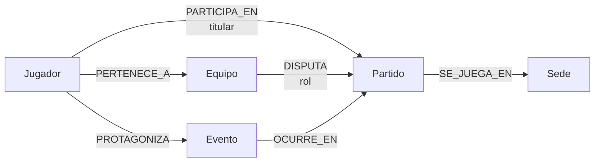

# Grupo 15 — Hito 5: Módulo de Grafos del Fixture 2030

## 1. Problema relacional

El módulo documental conserva la ficha de equipos y jugadores. El módulo de grafos se concentra en preguntas cuyo valor aparece al recorrer conexiones entre entidades:

- ¿Qué partidos disputa la selección de un jugador y en qué sedes?
- ¿En qué partidos participó efectivamente un jugador?
- ¿Qué jugadores enfrentaron a una determinada selección?
- ¿Qué jugador protagonizó un evento, en qué partido ocurrió y dónde se disputó?
- ¿Qué rivales quedan conectados por el fixture?
- ¿Qué equipos poseen mayor cantidad de rivales distintos?

Neo4j resulta útil en este módulo porque estas respuestas dependen del recorrido de relaciones y no de recuperar un documento aislado.

## 2. Criterio de modelado

Se adopta una regla simple:

> **Propiedad cuando el dato describe o clasifica una entidad; nodo o relación cuando aporta navegación entre entidades.**

También se mantiene una separación explícita respecto del módulo de estadísticas. Los nodos `Equipo` y `Jugador` contienen únicamente atributos propios de la entidad. No se almacenan goles, asistencias, atajadas, partidos internacionales ni métricas deportivas acumuladas.

## 3. Nodos

| Nodo | Propiedades | Criterio |
|---|---|---|
| `Equipo` | `id`, `nombre`, `pais`, `confederacion`, `grupo` | Identidad y clasificación de la selección |
| `Jugador` | `id`, `nombre`, `apellido`, `fechaNacimiento`, `nacionalidad`, `posicion`, `dorsal` | Atributos propios del jugador |
| `Partido` | `id`, `fecha`, `fase`, `jornada`, `estado` | Información de programación del encuentro |
| `Sede` | `id`, `nombre`, `ciudad`, `pais` | Lugar reutilizado por distintos partidos |
| `Evento` | `id`, `tipo`, `minuto`, `descripcion` | Hecho deportivo identificable dentro de un partido |

`grupo` se mantiene como propiedad de `Equipo` porque su uso principal es clasificar o filtrar selecciones. `fase` se mantiene como propiedad de `Partido` por el mismo motivo.

El minuto de un `Evento` es un atributo del hecho puntual y no una estadística acumulada del jugador.

## 4. Relaciones

| Relación | Dirección | Propiedades | Cardinalidad esperada | Uso |
|---|---|---|---|---|
| `PERTENECE_A` | `Jugador -> Equipo` | — | N:1 | Plantel de una selección |
| `PARTICIPA_EN` | `Jugador -> Partido` | `titular` | N:M | Distingue pertenencia de participación real |
| `DISPUTA` | `Equipo -> Partido` | `rol` | N:M | Participación de equipos; `local` o `visitante` |
| `SE_JUEGA_EN` | `Partido -> Sede` | — | N:1 | Programación geográfica |
| `PROTAGONIZA` | `Jugador -> Evento` | — | 1:N | Jugador relacionado con la acción |
| `OCURRE_EN` | `Evento -> Partido` | — | N:1 | Partido al que pertenece el evento |

No se incorpora una relación directa `Evento -> Equipo`, porque puede obtenerse recorriendo:

```text
Evento <- PROTAGONIZA - Jugador -> PERTENECE_A -> Equipo
```

De esta manera se evita almacenar una conexión redundante.

## 5. Diagrama conceptual



Propiedades de clasificación:

```text
Equipo.grupo
Partido.fase
Evento.tipo
Evento.minuto
```

## 6. Valor de `PARTICIPA_EN`

El recorrido:

```text
Jugador -> Equipo -> Partido
```

indica que el jugador pertenece a una selección que disputa un encuentro, pero no demuestra que el jugador haya participado.

La relación:

```text
Jugador -[:PARTICIPA_EN {titular}]-> Partido
```

representa ese hecho de manera explícita. La propiedad `titular` depende del jugador en ese partido concreto y, por lo tanto, pertenece a la relación.

No se guardan minutos jugados, goles, asistencias u otras métricas en esta relación.

## 7. Datos cargados

El dataset es sintético y determinístico:

| Entidad / relación | Volumen |
|---|---:|
| Equipos | 64 |
| Jugadores | 1.536 |
| Partidos | 127 |
| Sedes | 6 |
| Eventos | 508 |
| Relaciones `PARTICIPA_EN` | 4.572 |

Los IDs de equipos y jugadores siguen el mismo criterio del módulo documental:

```text
Equipo: E001
Jugador: E001-J01
```

La fase de grupos se representa mediante 16 grupos sintéticos de cuatro equipos. Cada grupo genera seis partidos, totalizando 96. Las etapas eliminatorias completan los 127 partidos del escenario.

## 8. Integridad e idempotencia

Se crean restricciones de unicidad para `id` en las cinco etiquetas.

La carga utiliza `MERGE`, de modo que una segunda ejecución actualiza o reutiliza entidades y relaciones existentes en lugar de crear duplicados.

Los controles verifican:

- jugadores sin equipo;
- partidos con una cantidad de equipos distinta de dos;
- partidos sin sede;
- eventos sin partido;
- eventos sin protagonista;
- participaciones duplicadas;
- jugadores participando en un partido que su equipo no disputa.

## 9. Índices

Además de los índices implícitos asociados a las restricciones únicas, se crean índices para consultas frecuentes:

| Índice | Consulta que favorece |
|---|---|
| `Equipo.grupo` | Equipos de un grupo |
| `Jugador.posicion` | Filtros por posición |
| `Partido.fase` | Partidos de una etapa |
| `Partido.fecha` | Programación temporal |
| `Evento.tipo` | Eventos de un tipo determinado |

No se indexan todos los atributos porque cada índice agrega almacenamiento y costo de mantenimiento.

## 10. Consultas implementadas

El módulo incluye:

1. equipos de un grupo;
2. partidos de una fase;
3. `Jugador -> Equipo -> Partido -> Sede`;
4. `Jugador -> Partido -> Sede` mediante participación real;
5. jugadores que participaron contra una selección;
6. `Jugador -> Evento -> Partido -> Sede`;
7. rivales mediante un partido compartido.

Las consultas 3 y 6 recorren tres relaciones consecutivas, superando el mínimo de dos saltos requerido.

## 11. Análisis relacional

### Camino más corto entre equipos

Se utiliza `shortestPath()` sobre relaciones `DISPUTA`.

La consulta responde cuántas conexiones de participación separan a dos selecciones dentro del subgrafo del fixture. La respuesta surge de la topología del grafo y no de una propiedad almacenada.

### Conectividad por rivales

Se cuentan los rivales distintos conectados a cada `Equipo` mediante partidos compartidos.

Esta consulta permite identificar qué selecciones tienen mayor diversidad de conexiones deportivas dentro del dataset cargado.

## 12. Relación con los hitos anteriores

El Hito 2 justificó el uso de un modelo de grafos para partidos, eventos y navegación de relaciones. El Hito 4 aporta la identidad de equipos y jugadores.

Neo4j no reemplaza al módulo documental ni replica toda su información. Solo reutiliza los identificadores y los atributos necesarios para los recorridos.

La arquitectura distribuida del Hito 3 queda como condicionante conceptual. Este hito implementa una instancia local para validar el modelo y las consultas, no un clúster distribuido.

## 13. Evidencia requerida

La entrega debe incluir evidencia real de ejecución:

- Neo4j activo en Docker;
- conteos de nodos;
- segunda carga con los mismos conteos;
- al menos un recorrido de varias relaciones;
- visualización del subgrafo en Neo4j Browser;
- restricciones e índices;
- resultados de las consultas de análisis.

El repositorio incluye `scripts/generar_evidencia.sh` para generar la evidencia textual. Las capturas visuales deben obtenerse de la ejecución real y guardarse en `docs/evidencia/`.

## 14. Limitaciones

- Los datos son sintéticos.
- No se integra MongoDB con Neo4j mediante código.
- No se implementa clustering en este hito.
- No se almacenan estadísticas deportivas acumuladas.
- `neo4j:latest` puede cambiar entre ejecuciones; debe registrarse la fecha e imagen probada antes de entregar.
