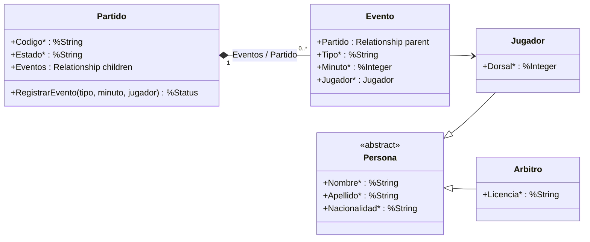

# Grupo 15 — Hito 9 — Entidades complejas del Fixture 2030 (InterSystems IRIS)

**Repositorio GitHub:** https://github.com/ttornillouade/Fixture-2030_DatosII_Grupo15

El partido del Fixture 2030 como clases persistentes de IRIS, con lo que pide la consigna: herencia,
una relación estructural, guardado atómico, navegación, proyección SQL y una validación encapsulada.

## Estructura

```text
hito-9-iris/
├── docker-compose.yml        IRIS Community + Durable %SYS en ~/docker/data/iris
├── scripts/
│   ├── Fixture/*.cls         Persona, Jugador, Arbitro, Partido, Evento
│   ├── demo_hito9.mac        demostración por bloques para el Terminal de IRIS
│   └── generar_evidencia.sh  compila, ejecuta la demo y guarda la salida
└── docs/evidencia/
```

## Operativa

Desde esta carpeta (instructivo de la Clase 10):

```bash
mkdir -p ~/docker/data/iris
sudo chown -R "$(id -u):$(id -g)" ~/docker/data/iris
sudo chmod -R 777 ~/docker/data/iris
docker compose up -d
docker exec -it fixture2030-iris iris session IRIS
```

```objectscript
do $system.OBJ.LoadDir("/scripts/Fixture", "ck")
```

Después, copiar en el Terminal los bloques de [`scripts/demo_hito9.mac`](scripts/demo_hito9.mac), o
ejecutar la demo completa y guardar la salida con `bash scripts/generar_evidencia.sh`.
Detener sin perder datos: `docker compose down`.

## Diseño

| Requisito | Implementación |
|---|---|
| Herencia (RF4) | `Persona` (abstracta) → `Jugador` (`Dorsal`) y `Arbitro` (`Licencia`) |
| Relación estructural (RF3) | `Partido` ↔ `Evento`, padre-hijo, con índice `PartidoIdx` en el lado hijo (RNF3) |
| Propiedades obligatorias (RF5) | `[Required]` en todos los atributos de negocio |
| Guardado atómico (RF6) | Un solo `%Save` del partido guarda sus eventos y el jugador referenciado |
| Navegación (RF7) | `%OpenId`, `Eventos.GetAt(1)`, `evento.Jugador`, `evento.Partido` |
| Proyección SQL (RF8) | `SELECT` sobre `Fixture.Persona` y `Fixture.Evento` |
| Validación encapsulada (RF9) | `Partido.RegistrarEvento` rechaza eventos en un partido `FINALIZADO` |



`*` = `[Required]`.

### Matriz de integridad

| Regla | Mecanismo | Demo |
|---|---|---|
| Los atributos de negocio son obligatorios | `[Required]` | Bloque E: jugador sin `Dorsal`, rechazado |
| El partido y sus eventos se guardan juntos | `%Save()` del padre, en una transacción | Bloque B |
| **Si se borra un partido, se borran sus eventos** | Relación padre-hijo | Bloque G |
| Un partido finalizado no admite eventos | `Partido.RegistrarEvento` | Bloque F |

## Evidencia

[`docs/evidencia/`](docs/evidencia/): versión de IRIS, compilación sin errores y la salida de cada bloque.

## Mejoras propuestas (no implementadas)

- Equipos con su plantel (relación uno a muchos), sedes y direcciones embebidas.
- Restricciones de valores (estados y tipos de evento cerrados, rangos de minuto y dorsal).
- Una máquina de estados completa del partido (programado, en juego, finalizado).
